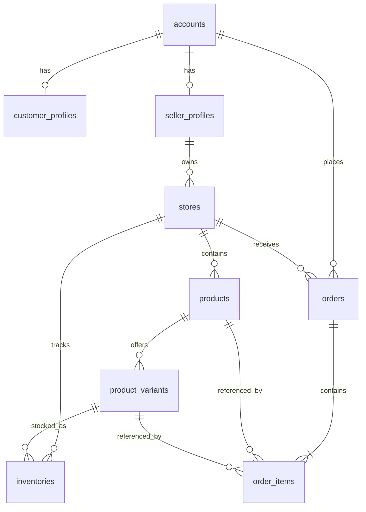

# Marketplace foundation

Account is the only authentication principal. CustomerProfile and SellerProfile are optional independent personas with unique account foreign keys. Seller application begins PENDING; an ADMIN can approve or reject it. Approval and the canonical SELLER role grant commit in one PostgreSQL transaction. A rejected applicant may reapply, returning to PENDING. Approved sellers may create multiple Stores. Store, catalog, and inventory mutations require both the SELLER role and current ownership; an account's global role never proves ownership of another Store. Store mutations also check current account status and SellerProfile approval.

Product price has **one authoritative source**, ProductVariant.priceCents, stored as nonnegative integer minor currency units. The current foundation assumes a single currency configured outside this model; multi-currency pricing needs a separate contract. SKU is globally unique in this MVP, which is stricter than store-scoped uniqueness. A public product read requires ACTIVE Store, Product, and Variant as applicable. DRAFT or inactive resources are hidden from public catalog reads.

Inventory is per Store and ProductVariant with a unique pair and nonnegative integer quantity. A PostgreSQL trigger rejects a variant from another Store. Stock adjustments use one conditional UPDATE; concurrent decrements cannot drive quantity below zero. Orders intentionally **do not reserve or decrement stock**. Inventory therefore does not yet prevent overselling through Order creation. Checkout, reservation, payment, tax, shipping, and multi-store checkout require separate design.

Each Order belongs to one customer Account and one Store. Creation is allowed only for an ACTIVE customer Account, ACTIVE Store, and ACTIVE Products/Variants. The order is created in a transaction with one or more OrderItems. Each item stores immutable product name, SKU, unit price, quantity, and line total snapshots. A database trigger prevents later updates to item snapshots. Order status is `CREATED`; fulfillment, cancellation, payment, refunds, and stock commitment are deferred. Buyer reads require matching Account ID; seller reads require ownership of the Order's Store. The two checks are independent.

## HTTP endpoints

| Resource | Endpoints |
| --- | --- |
| Customer profile | `GET/POST/PATCH /customer/me` |
| Seller onboarding | `GET /seller/me`, `POST /seller/apply`, ADMIN `PATCH /seller/:id/approve`, `PATCH /seller/:id/reject` |
| Store | `GET /stores/:id`, seller `GET /stores/mine`, `POST /stores`, `PATCH /stores/:id` |
| Catalog | `GET /catalog/stores/:storeId/products`, `GET /catalog/products/:id`, `GET /catalog/variants/:id`, seller `POST /catalog/stores/:storeId/products`, `PATCH /catalog/products/:id`, `POST /catalog/products/:id/variants`, `PATCH /catalog/variants/:id` |
| Inventory | seller `GET/POST /stores/:storeId/inventory/:variantId`, `PATCH /stores/:storeId/inventory/:variantId/adjust` |
| Order | `POST /orders`, buyer `GET /orders/me`, `GET /orders/:id`, seller `GET /orders/stores/:storeId/:id` |

All HTTP JSON uses camelCase; PostgreSQL uses snake_case. The five additive marketplace migrations follow AccountSession: business profiles, Stores, catalog, inventory, and Orders.
